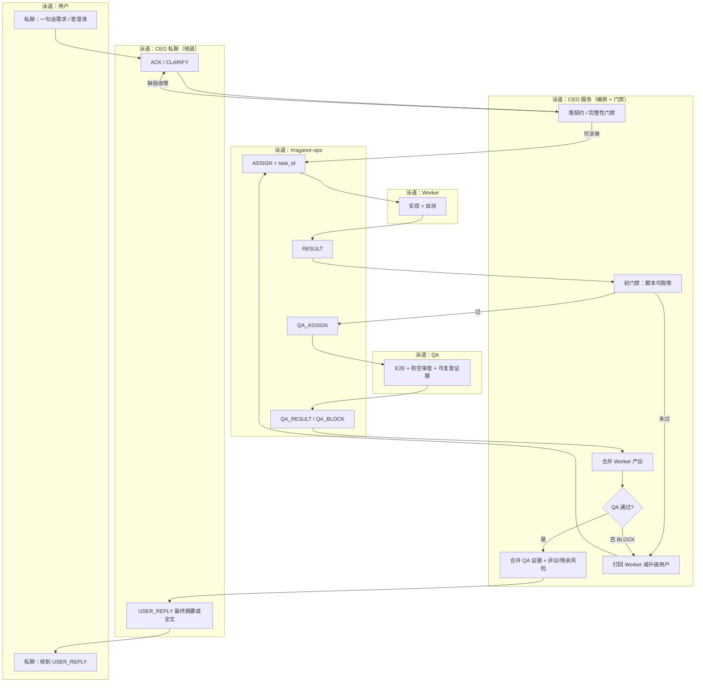
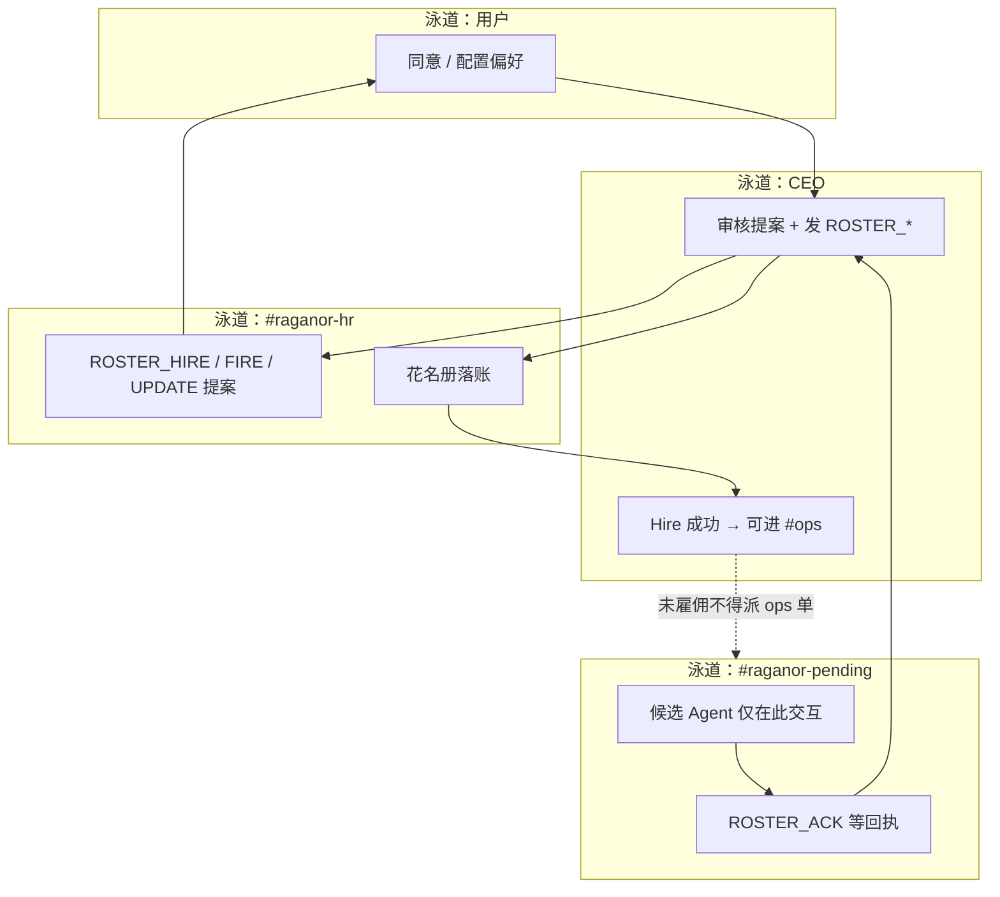
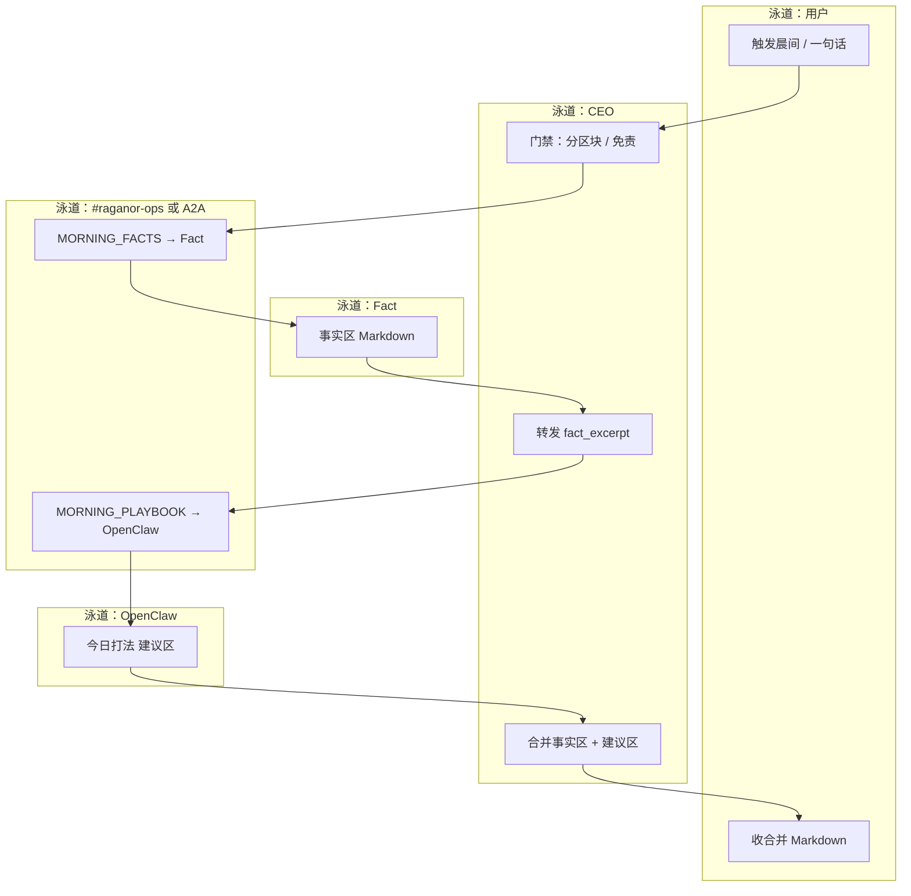

# Raganor 系统设计总览

**版本**：2026-03-20  
**性质**：一体设计叙述 + **工作流泳道图**；与 **`v0.1/`** 专题文档**互补**——表格、INTENT 全集、决议模板、配置键等仍以原文为准。

---

## 0. 文档定位

| 需求 | 去哪读 |
|------|--------|
| 信封格式、INTENT 表、§6 花名册全文 | [v0.1/community-chat-paradigm.md](../../v0.1/community-chat-paradigm.md) |
| CEO 硬规格、可靠性 KPI | [v0.1/orchestration.md](../../v0.1/orchestration.md) |
| 异议与决议模板 | [v0.1/governance.md](../../v0.1/governance.md) |
| QA / E2E / `QA_*` | [v0.1/qa-role-and-e2e.md](../../v0.1/qa-role-and-e2e.md) |
| CEO 工程（TS、FSM、频道 ID） | [v0.1/ceo-agent-architecture.md](../../v0.1/ceo-agent-architecture.md) |
| 记忆与 KB 分层 | [v0.1/memory-and-knowledge-design.md](../../v0.1/memory-and-knowledge-design.md) |
| 晨晚简报与场景 A | [v0.1/personal-butler.md](../../v0.1/personal-butler.md) |
| 业务清单与人设 | [docs/company-agent-platform.md](../company-agent-platform.md)、[docs/agent-culture.md](../agent-culture.md) |
| 全路径索引 | [DOCUMENT-MAP.md](./DOCUMENT-MAP.md) |

---

## 1. 愿景与边界

构建 **一人公司式多 Agent 协作**：用户主要对接 **CEO**；CEO 负责 **调度、门禁、合并结论、对用户的单出口**；成员异构、可跨机。通过 **外置状态、机械验收、E2E、异议记录** 降低长程失败率，抑制迎合与一致幻觉。

**边界**（与 orchestration 一致）：无客观验收的开放任务不承诺高成功率；成功由 **契约 + 自动化/状态 + 流程** 定义，**不能**仅靠 LLM 口头判定「完成」。

---

## 2. 角色与架构总览

| 角色 | 职责 | 实现倾向 |
|------|------|----------|
| 用户 | 一句话 + 回答引导式澄清 | 人 |
| **CEO** | 任务图/阶段机、契约门禁、合并、**唯一对用户出口** | **自建优先**（状态机 + 校验 + 可选 LLM） |
| **Worker** | 子任务执行（实现、Fact、OpenClaw 建议等） | 可 OpenClaw / 自建 / 跨机 |
| **QA** | 对照契约、E2E、防空测试、**可复查证据**；`QA_RESULT` / `QA_BLOCK` | **必设**（功能类任务默认） |

**与 subagent 树对比**：单点调度、外置 SSOT、运行时门禁、商量有界、**对用户只经 CEO 私聊 `USER_REPLY`**（公群留痕）。

**OpenClaw**：宜作 **Worker**（工具与表达）；CEO 宜为 **独立编排层**，不宜用「大模型监工」替代硬门禁。

---

## 3. CEO 架构：薄编排 + 硬门禁

**硬能力（须能 enforce）**：

- 任务图 / 阶段、外置状态、`task_id` / `correlation_id` 全链路一致。  
- **契约完整性**：缺验收、范围、环境指针等 → `CLARIFY` 或拒派。  
- 产物 schema、脚本/测试门槛；商量次数/超时在网关或代码中限制。  
- **合并与出口**：处理异议（见 governance）；对用户宣称成功须满足门禁，或 **带风险通过** 并记录残余风险。  
- **功能类任务**：未收到合规 **`QA_RESULT`（通过）** 前，**不得**在 `USER_REPLY` 中断言功能完成。

**软能力（可用 LLM）**：意图理解、拆任务草稿、友好 `ACK`、失败说明文案；**不可**仅凭模型判断「阶段推进 / 成功」。

详见 [v0.1/orchestration.md](../../v0.1/orchestration.md) §4、§5 与 [v0.1/ceo-agent-architecture.md](../../v0.1/ceo-agent-architecture.md)。

---

## 4. Community-chat：拓扑、用法与时机

### 4.1 已定拓扑（摘要）

| # | 类型 | 名称 | 成员 | 用途 |
|---|------|------|------|------|
| 1 | 私聊 | **你 ↔ CEO** | 仅你与 CEO | **主入口**：下命令；`ACK` / `CLARIFY`；**`USER_REPLY`**（最终交付摘要或全文）。 |
| 2 | 频道 | `#raganor-ops` | CEO + **已雇佣** Agent + 你（可选） | **业务编排**：`ASSIGN` / `ACK` / `RESULT`、`QA_*`；全程 **`task_id`**；可审计。 |
| 3 | 频道 | `#raganor-hr` | CEO + 你 + 全员可读 | **人事**：`ROSTER_*`、`USER_APPROVE_*`；Hire/Fire 提案与同意。 |
| 4 | 频道 | `#raganor-pending` | **未雇佣** Agent 等 | **入司前仅限此**；`ROSTER_ACK` 等；**不得进 ops**。 |

**配置键**（CEO 服务）：`CHANNEL_ID_CEO_DM`、`CHANNEL_ID_OPS`、`CHANNEL_ID_HR`、`CHANNEL_ID_PENDING` — 见 ceo-agent-architecture §6。

**强制校验**：当前 **不做**服务端拦截；范式为 **Agent 实现侧约定**，由 CEO/编排自愿遵守（见 paradigm 文首）。

### 4.2 何时用哪个场（口诀）

- **要交付、要协作、要留痕** → **`#raganor-ops`** + 信封 + INTENT + `task_id`。  
- **要招人/改权限/注册 agent** → **`#raganor-hr`** / **`#raganor-pending`**（未雇佣不入 ops）。  
- **给用户的最终话、敏感信息** → **CEO 私聊**（`USER_REPLY`）；公群可作旁听审计。  
- **无 `task_id` 的长聊** → 不得冒充工作结论；参与讨论不等于改派，**CEO** 决定是否采纳。

全文、信封与 INTENT 表：[v0.1/community-chat-paradigm.md](../../v0.1/community-chat-paradigm.md)。

---

## 5. 交付物与「助理/执行者」人感

**拆两层，避免二选一**：

| 层 | 负责 | 典型承载 |
|----|------|----------|
| **交付层（硬）** | PR、路径、CI artifact、契约验收项、结构化 Markdown 区块 | Fact / Worker 产出；QA 证据 |
| **表达层（软）** | 称呼、过渡、共情短句、把列表说成「像助理在汇报」 | OpenClaw 或专用 Voice Worker |

**原则**（对齐 personal-butler 场景 A）：**事实与建议分栏**；表达层 **不得新增事实**，只基于 CEO 门禁后的摘要生成建议或话术；**失败降级**（如 OpenClaw 不可达）→ CEO 仍发事实区 + 明确跳过说明。

---

## 6. CEO + QA：最后一道关

**默认三角**：

```text
CEO → Worker（实现+自测）→ CEO（初门禁）→ QA（E2E+证据+防空）→ CEO（合并）→ 私聊 USER_REPLY → 用户
```

**QA 必须**：对照契约；跑约定 **E2E**；防空测试审查；**`QA_RESULT` 附可复查链接/日志** — 禁止仅口头「通过」。**`QA_BLOCK`** 时 CEO 不得对用户宣称功能完成。

**简报类**（纯读盘渲染）：可轻量门禁 + 快照；**一旦涉及 CLI/API/页面**，默认 **QA + E2E**。

详见 [v0.1/qa-role-and-e2e.md](../../v0.1/qa-role-and-e2e.md)。

---

## 7. 简洁高效原则（归纳）

1. **用户只认一个老板**：私聊 CEO；其他为后台角色。  
2. **公群只谈带 `task_id` 的工作**；人事与待聘隔离。  
3. **CEO 薄**：状态机 + 校验 + 可选 LLM；重逻辑进仓库与 CI。  
4. **人感可插拔**：绑在已合并的结构化结果之后。  
5. **功能交付必过 QA 证据链**。

---

## 8. 工作流泳道图（Mermaid）

### 8.1 功能交付（CEO → Worker → QA → 用户）



### 8.2 人事 / 待聘（与 ops 隔离）



### 8.3 晨间简报 · 场景 A（Fact → OpenClaw，经 CEO）



---

## 9. 记忆、治理与产品支线（指针）

- **记忆与知识**：运营库（CEO SQLite）vs Git KB vs Agent 长短期记忆 — [v0.1/memory-and-knowledge-design.md](../../v0.1/memory-and-knowledge-design.md)。  
- **博弈与决议模板**： [v0.1/governance.md](../../v0.1/governance.md)。  
- **个人管家 v1 可执行拆分**： [docs/issues/personal-butler-v1-brief/](../issues/personal-butler-v1-brief/)、依赖见 [docs/issues/README.md](../issues/README.md)。  
- **Platform v1（CEO + community-chat）**： [docs/issues/platform-v1-brief/](../issues/platform-v1-brief/)（与个人管家 v1 **可并行**，**非**个人管家 v2）。  
- **主动提醒 / 咨询 / heartbeat 类能力**（若产品扩展）：建议 **调度与合规在系统层**、**人味表达在 Worker**；与「每日主动条数预算」相关的策略 **当前产品未强制采用**，可按需后续单列。

---

## 10. 变更说明

重大文档结构变更见 [v0.1/CHANGELOG-v0.1.md](../../v0.1/CHANGELOG-v0.1.md)。

---

*本文与 `v0.1/` 冲突时，以 **`v0.1/` 专题文档** 为规范准绳，并应回写修正本总览。*
